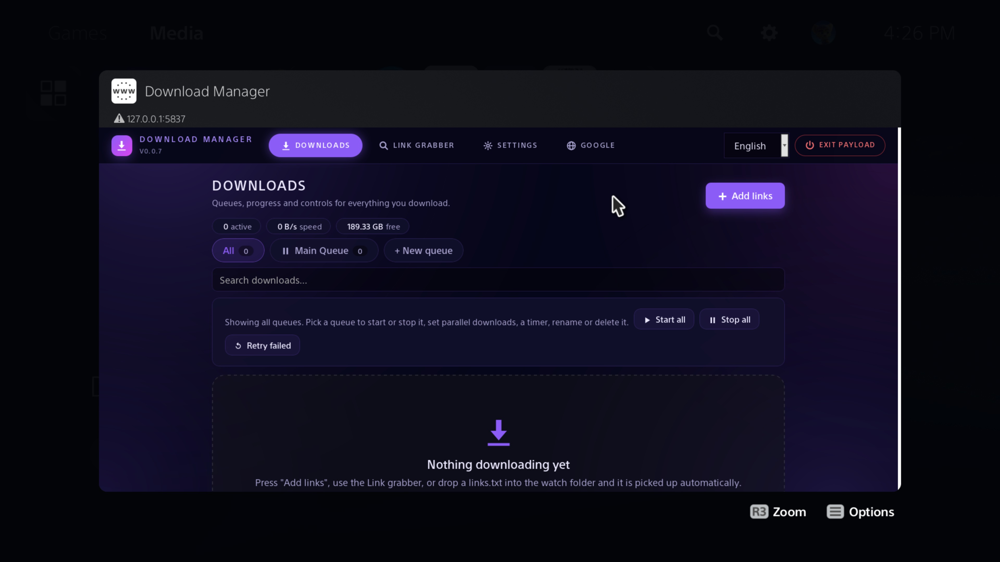

<p align="center">
  
</p>

# PS5 Download Manager

[](https://crowdin.com/project/ps5-download-manager)
[](LICENSE)

A web-based download manager for your jailbroken PS5. It runs as a native payload (`dlmgr.elf`), hosts its UI on **port 5837**, and opens in the PS5 browser from a shortcut in the Media tab, or from any device on your LAN.
<p align="center">
  
</p>

## Features

- **Queues**: Up to 16 named queues, each with its own "downloads at once" limit (1-8), Start/Stop, rename and delete. Reorder items and move them between queues. A queue can start another queue when it finishes.
- **Segmented downloads**: 1-8 connections per file (default 4), pause/resume, retry with backoff, resume after a payload crash or reboot, redirects, `Content-Disposition` names, single-stream fallback when a server ignores `Range`, and a free-space check.
- **Speed limits**: Per-download limit in Settings plus an optional total limit per queue (the tighter one wins).
- **Queue timer**: Auto start/stop a queue inside a daily time window, also across midnight.
- **Link grabber**: Enter a page address and the console lists every link it finds. Likely files (zip, rar, iso, pkg, mp4, ...) are pre-ticked.
- **Automatic intake**: Queues auto-start, watch folders import `.txt` link lists, and a bookmarklet/API sends links from your PC or phone.
- **Folder browser**: File-manager style picker for the save folder, with USB and extended drives detected automatically.
- **Notifications**: PS5 notifications when a download finishes or fails and when a queue finishes (off / queue finished / every download).
- **Duplicate detection**: A link already in the list is refused; a link downloaded before is added with a warning.
- **Home Screen Shortcut**: Installs a "Download Manager" icon in the Media tab (can be turned off in Settings).
- **Languages**: UI text is translated through Crowdin; RTL is applied for `fa`, `ar`, `he` and `ur`.

## Requirements

- A PS5 homebrew environment capable of running payload ELFs (an ELF loader listening on port `9021`).
- Another way to launch `dlmgr.elf` also works, for example a payload manager.

This is homebrew software. Keep backups of important data and test with non-critical downloads first.


## Usage

### Getting started

1. Send `dlmgr.elf` to your console with your ELF loader (port `9021`), or start it from a payload manager.
2. Open the **Download Manager** icon in the Media tab, or browse to `http://<console-ip>:5837` from any device on your LAN.
3. Press *Add links*, paste your links and pick a queue and folder.

### Save folders

Downloads are only allowed into:

- `/data/DownloadMGR/…` (default)
- `/mnt/usbN/DownloadMGR/…`
- `/mnt/extN/DownloadMGR/…`

The drive folders are created automatically when a drive is mounted. State lives in `/data/DownloadMGR/` (`state.db`, `settings.cfg`, `token`).

### Watch folders

Drop a `.txt` file with one link per line (optional `url|filename`) into `/data/DownloadMGR/watch/` or `/mnt/usbX/DownloadMGR/`. It is imported within a few seconds and renamed to `.done`.

### Link grabber

Enter a page address. The console loads it (up to 3 MB) and lists relative, `//`, absolute, and script/JSON-embedded links. When a page has no direct file links it also offers download-button style links (`dl.` hosts, `/download/`, `/go/`, ...). Direct file links are refused with a message, so use *Add links* for those.

It only sees the page's HTML, so pages that build their links with JavaScript, need a login, or sit behind a captcha will list nothing useful.

## Building from source

Builds are done on Linux. On Windows, use WSL. The release workflow (`.github/workflows/release.yml`) does exactly the steps below on Ubuntu, so it is the reference if something differs on your machine.

### 1. Install the toolchain packages

```
sudo apt-get install -y bash clang-18 lld-18 wget python3 make
```

`wget` is used by the Makefile to fetch the CA bundle (`cacert.pem` from curl.se) during the first build, so the build machine needs internet access.

### 2. Install the PS5 payload SDK

Download `ps5-payload-sdk.zip` from the [ps5-payload-dev/sdk releases](https://github.com/ps5-payload-dev/sdk/releases) and unpack it, for example into `/opt`:

```
wget -O /tmp/sdk.zip https://github.com/ps5-payload-dev/sdk/releases/latest/download/ps5-payload-sdk.zip
sudo unzip -q -d /opt /tmp/sdk.zip
```

The SDK ends up in `/opt/ps5-payload-sdk`. The Makefile uses `SDK=/opt/ps5-payload-sdk` by default, and you can point `SDK=` somewhere else.

### 3. Install the static libraries

libcurl, OpenSSL and libmicrohttpd are not part of the SDK. They come from the [ps5-payload-dev/pacbrew-repo](https://github.com/ps5-payload-dev/pacbrew-repo) releases. Download the latest release archive, unpack it (for example into `/tmp/pb`), find the `target/user/homebrew` folder inside it, and copy that folder into the SDK:

```
SRC=$(find /tmp/pb -type d -path '*/target/user/homebrew' | head -1)
sudo mkdir -p /opt/ps5-payload-sdk/target/user
sudo cp -a "$SRC" /opt/ps5-payload-sdk/target/user/
```

Check that these files exist in `/opt/ps5-payload-sdk/target/user/homebrew/lib`: `libcurl.a`, `libssl.a`, `libcrypto.a` and `libmicrohttpd.a`. The build links them statically, together with their dependencies, which it reads from the `.pc` files in `lib/pkgconfig`.

### 4. Build

```
make SDK=/opt/ps5-payload-sdk
```

The build runs in this order:

1. `tools/build_frontend.py` merges `frontend/index.html` and every `frontend/locales/*.json` into one HTML file (`build/index.html`).
2. `tools/gen_assets.py` gzips that page and the CA bundle into C headers in `include/`.
3. `prospero-clang` compiles `src/*.c`, links the static libraries, and strips the result.

The output is `dlmgr.elf`.

## Project structure

```
.
├── src/
│   ├── main.c              startup, watchdog (restarts the server on IP change / wake from rest mode)
│   ├── engine.c            queues, segmented downloader, persistence, watch folders, link grabber
│   ├── server.c            HTTP server and API
│   └── platform_ps5.c      notifications, process hygiene, Media-tab app install
├── include/
│   └── dlmgr.h             shared declarations and DL_VERSION (generated asset headers are written here)
├── frontend/
│   ├── index.html          the whole UI in one file
│   └── locales/            UI translations, en.json is the source (managed with Crowdin)
├── assets/
│   ├── icon0.png           icon of the Media-tab shortcut
│   └── param.json          metadata of the Media-tab shortcut
├── tools/
│   ├── build_frontend.py   merges the page and the locales into one HTML file
│   ├── gen_assets.py       turns files into gzipped C arrays
│   └── map_top.py          size report for the linker map (make size)
├── .github/workflows/
│   ├── release.yml         builds the ELF and publishes a release
│   └── crowdin.yml         syncs frontend/locales with Crowdin
├── Makefile
├── LICENSE
└── README.md
```

## Translations

[](https://crowdin.com/project/ps5-download-manager)

The UI is translated on [Crowdin](https://crowdin.com/project/ps5-download-manager). `frontend/locales/en.json` is the source file, and the other `frontend/locales/*.json` files are generated from Crowdin, so please translate there and do not edit them by hand, because the next sync would overwrite your changes. Strings that are not translated yet fall back to English.

- **Translate or proofread:** open the Crowdin project, choose your language and start translating.
- **Keep placeholders:** tokens such as `{n}`, `{name}` and `{dir}` must stay exactly as they are.
- **Missing language:** open an issue or ask on Crowdin and it will be added.
- **Note: please don't add translations via PRs (PRs for translations will be closed)**

## Disclaimer

Experimental PS5 homebrew software. Use at your own risk. Not affiliated with Sony, PlayStation, or any game publisher.


## Credits

❤️ inspo from PS5 Overdrive

❤️ Built on [ps5-payload-dev/sdk](https://github.com/ps5-payload-dev/sdk).

❤️ Clean-ups & help with Crowdin (I didn't know how to set it up & probably I won't use it again 😶‍🌫️) by [Claude](https://claude.ai) (Anthropic AI) 

---

## License

Licensed under the [GNU General Public License v3.0](LICENSE) or (at your option) any later version.
